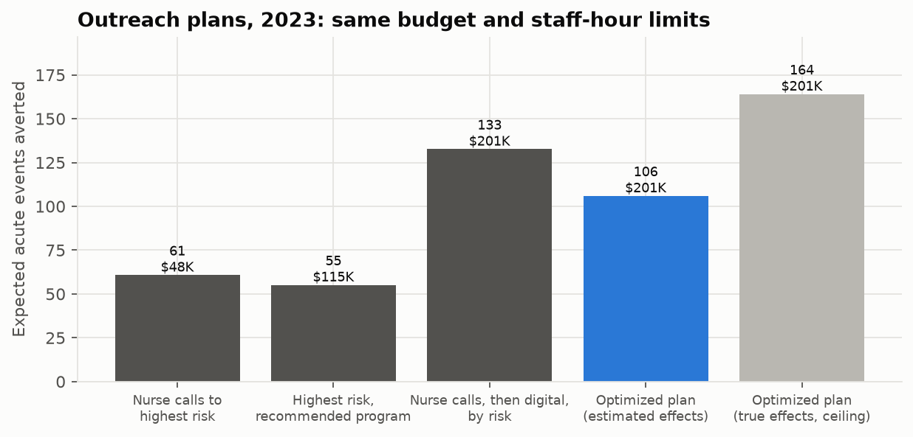
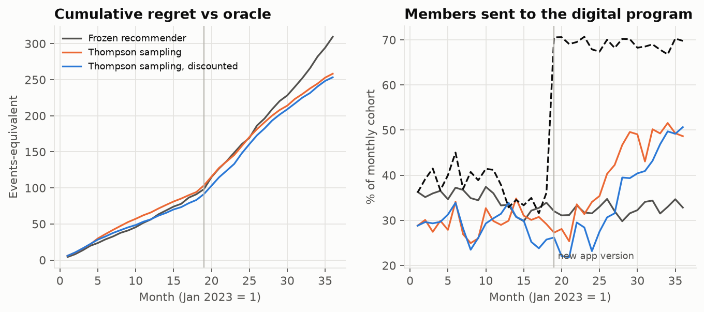
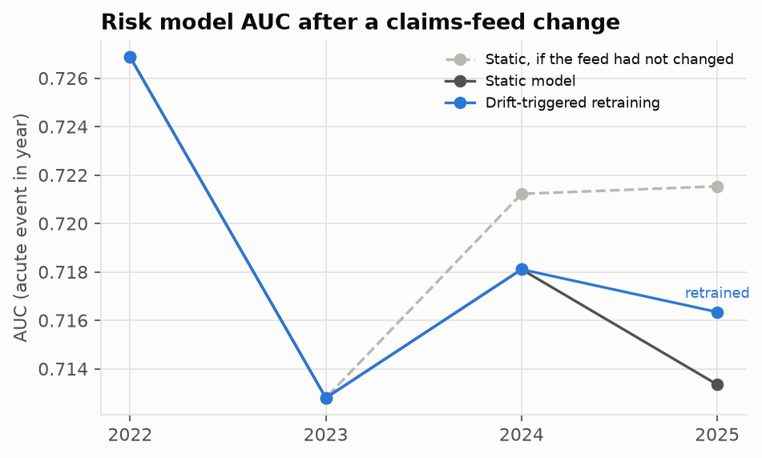
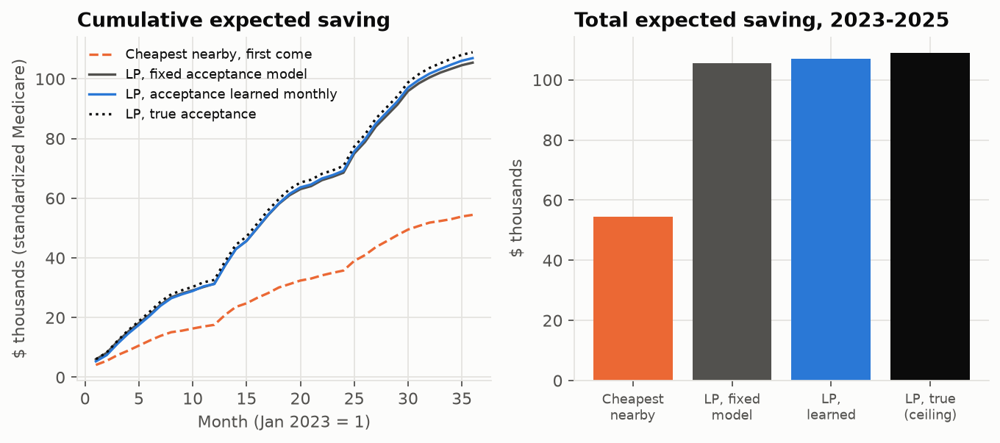

# Care-Management Outreach: Prescriptive Analytics on Synthetic Members

A health plan's care-management team has a fixed budget and a fixed number of nurse and pharmacist hours. Its
questions are prescriptive: **which members** to contact, **with which program**, and **how to keep learning** as
programs and data change. This project answers them end to end on ~11,000 synthetic North Carolina members aged 40+.

| Step | Technique | Module |
|---|---|---|
| Predict who will have an ED visit or inpatient stay | Deep learning (GRU over 24 months of utilization + MLP), benchmarked against gradient boosting and logistic regression | `risk.py` |
| Recommend the best program for each member | Uplift / causal meta-learners (S, T, doubly robust, risk-anchored), selected by cross-validated off-policy value on a randomized pilot | `uplift.py` |
| Allocate programs under budget, staff-hour and capacity limits | Integer program (multiple-choice knapsack, HiGHS) | `optimize.py` |
| Keep learning after deployment | Contextual bandit (linear Thompson sampling, one-step reinforcement learning) | `bandit.py` |
| Keep the risk model current | Evidently drift monitoring, MLflow tracking, model registry and champion/challenger retraining | `monitor.py` |
| Steer members to high-value physical therapists | Capacitated assignment LP on real CMS provider costs, choice model, Thompson-sampled acceptance learning, FWA integrity guardrail | `steer.py` |

> **Synthetic data, simulated effects.** Members come from [Synthea](https://github.com/synthetichealth/synthea).
> No public dataset records how members respond to outreach, so program effects are simulated on top of each
> member's real (synthetic) untreated outcome, as semi-synthetic causal benchmarks such as IHDP do. That makes every
> policy exactly scoreable against the truth, which real data never allows; the numbers show how the methods compare,
> not what a real program would achieve.

## Data

`synthea -p 10000 -a 40-90 "North Carolina"` (seed 20261003, CSV export of patients, encounters, conditions and
medications, 15 years of history). `data.py` builds one row per member and outcome year 2015–2025 (108,300
member-years, acute-event rate 18%):

- **Label:** any emergency visit or inpatient stay in the year.
- **Tabular features:** age, sex, income; prior-year ambulatory, urgent, ED, inpatient and post-acute counts and
  cost; ED and inpatient use two years back; 12 chronic-condition flags; active medications.
- **Sequence:** monthly ambulatory, urgent, ED and inpatient counts and log cost for the 24 months before the year.

Years: risk model trained on 2015–2020, validated on 2021; 2022 is a plan-wide randomized pilot; 2023 is the
deployment year; the bandit runs 2023–2025; monitoring scores 2022–2025.

## Run it

Requires [uv](https://docs.astral.sh/uv/) and Java 17+ (for Synthea).

```bash
# 1. generate members (about 40 minutes; needs ~5 GB RAM)
curl -LO https://github.com/synthetichealth/synthea/releases/download/master-branch-latest/synthea-with-dependencies.jar
java -Xmx4500m -jar synthea-with-dependencies.jar -s 20261003 -cs 20261003 -p 10000 -a 40-90 \
  --exporter.baseDirectory=./data/synthea/ --exporter.csv.export=true \
  --exporter.csv.included_files=patients.csv,encounters.csv,conditions.csv,medications.csv \
  --exporter.fhir.export=false --exporter.hospital.fhir.export=false --exporter.practitioner.fhir.export=false \
  --exporter.years_of_history=15 "North Carolina"

# 2. run the pipeline (about 6 minutes on 2 CPU cores)
uv sync
uv run care-outreach providers --fwa-dir ../MedicareFWA   # provider extract for steering (see section 6)
uv run care-outreach all          # or one step: build | risk | plan | bandit | monitor | steer
uv run pytest -q

# 3. browse experiments, runs and registered models
uv run mlflow ui --backend-store-uri sqlite:///mlflow.db
```

Outputs: `reports/*.json`, `reports/figures/*.png`, Evidently drift reports `reports/drift_<year>.html` (2024, the
year the feed change is detected, is committed), and the
MLflow store `mlflow.db` (experiments `acute-risk`, `next-best-action`, `outreach-plan`, `outreach-bandit`,
`acute-risk-monitoring`; registered models `acute-risk` and `acute-risk-adaptive`).

## 1. Risk model: deep learning vs. established methods

Deployment year 2023 (10,060 members), out-of-time test.

| Model | AUC | Average precision | Top-decile lift | Brier |
|---|---|---|---|---|
| Logistic regression | 0.680 | 0.377 | 2.50× | 0.134 |
| Gradient boosting (HistGB) | 0.704 | 0.415 | 2.77× | 0.129 |
| **GRU + MLP (PyTorch)** | **0.713** | **0.436** | **2.96×** | **0.127** |

The deep model wins on every metric. Paired bootstrap of the test AUC: +0.009 [+0.002, +0.016] over gradient
boosting and +0.033 [+0.024, +0.042] over logistic regression. The monthly sequence carries timing (recent vs.
old utilization) that yearly counts flatten. It was chosen on validation AUC and registered in MLflow as
`acute-risk@champion`.

## 2. Which program for whom: uplift from a randomized pilot

Five options, with semi-synthetic effects that differ by member (`simulate.py`): no outreach; nurse call ($60, 1 h;
helps heart failure / COPD and recent acute use); pharmacist medication review ($150, 2 h; polypharmacy, CKD);
home visit ($450, 4 h; oldest members, heart failure / dementia); digital coaching ($25; engagement falls with
age). In 2022 every member is randomized to one of the five (9,996 members).

Four learners are compared: S-learner, T-learner, doubly robust DR-learner (cross-fitted), and a risk-anchored
Poisson model that uses the deep model's score as an offset. Selection uses **pilot data only**: 5-fold
cross-validated, inverse-propensity-weighted events per member under each learner's budgeted plan (unbiased because
assignment was random). The S-learner was selected (0.163 events per member vs. 0.180 with no outreach).

## 3. Budgeted plan: integer program

For 2023, the plan gets $20 and 0.08 staff hours per member ($201K, 805 hours) and at most 201 home visits.

```
maximize   Σ_i Σ_a  benefit_ia · x_ia
subject to Σ cost_a · x_ia ≤ budget,   Σ hours_a · x_ia ≤ staff hours,   Σ_i x_i,home ≤ capacity,
           Σ_a x_ia ≤ 1 for each member,   x ∈ {0, 1}
```



| Plan (same limits) | Events averted | Spend | vs. nurse calls |
|---|---|---|---|
| Nurse calls to the highest-risk members (common practice) | 61 | $48K | – |
| Highest risk, each given the recommended program | 55 | $115K | −9% [−18, −1] |
| Nurse calls, then digital coaching, both by risk | 133 | $201K | +118% [+106, +134] |
| **Integer program on estimated effects** | **106** | **$201K** | **+74% [+59, +92]** |
| Integer program on the true effects (ceiling) | 164 | $201K | +170% |

- The optimizer uses the whole budget and program mix that nurse-only outreach cannot (staff hours run out after
  805 calls).
- **The binding constraint is estimating effects, not optimizing.** With the true effects the same integer program
  averts 164 events; with effects estimated from a one-year pilot it averts 106, and a simple risk-ranked
  nurse-then-digital rule (133) does better. The recommender agrees with the truly best program for 28% of members
  (about chance for four programs) and captures 63% of the best-program benefit, against 56% for giving everyone
  a nurse call. A larger pilot, or effect estimates pooled across years, is the lever.
- Ranking by risk and then choosing the program is worse than either: high risk is not the same as high benefit.

## 4. Online learning: contextual bandit

Members arrive in monthly cohorts over 2023–2025 (36 months, 30,206 member-months). Each month the policy picks a
program per member, sees whether an acute event followed, and updates. Reward = events averted − 0.0005 × $ cost.
Midway (month 19) the digital program gets a new app version and its effect rises 2.5×. All learning policies are
warm-started from the pilot.

- **Frozen recommender:** the pilot-trained model, never updated.
- **Thompson sampling:** one Bayesian linear model per program over baseline risk and risk × features, a posterior
  draw per member.
- **Discounted Thompson sampling:** the same, with monthly forgetting (γ = 0.97) so old evidence fades.

Protocol: the exploration scale (1, 0.5, 0.25) was chosen on months 1–12 only; months 13–36 are the evaluation
window.

| Months 13–36 | Value (events-equivalent) | Events averted | Spend |
|---|---|---|---|
| Frozen recommender | 168 | 275 | $213K |
| **Thompson sampling** | **229** | **467** | $477K |
| Thompson sampling, discounted | 224 | 428 | $408K |
| Oracle (true effects) | 421 | 653 | $464K |

Across five random seeds, Thompson sampling beat the frozen recommender in every run: value +34% to +53%
(229–260 vs. 168–172). After the app update, the learning policies move members into the digital program
(29% → 41% of each cohort), while the frozen model stays near 33%. The oracle moves to 69%, so there is room left.



## 5. Keeping the risk model current: Evidently + MLflow

Scenario: from January 2023 a new claims clearinghouse drops place-of-service detail on 70% of facility claims, so
ED visits and inpatient stays arrive as ambulatory encounters. Labels, from adjudicated claims, are unaffected.

Each year, before scoring:

1. An Evidently data-drift report compares the year's features with the current model's training data.
2. The latest labeled year is checked for an AUC drop.
3. Drift in a key utilization feature (ED, inpatient, acute history), 30% of features drifting, or a 0.03 AUC drop
   triggers retraining. The first trigger marks a change point.
4. A challenger is trained on labeled data since the change point. The deep model is fine-tuned from the
   champion's weights. It is logged and registered in MLflow, and the `champion` alias moves only if the
   challenger beats the champion on a 30% holdout of the latest labeled year.

| Year | Drifted features (Evidently) | Action | AUC static | AUC adaptive |
|---|---|---|---|---|
| 2022 | age, ambulatory, cost, medications | none (no key feature) | 0.727 | 0.727 |
| 2023 | age, medications | none | 0.713 | 0.713 |
| 2024 | **ED visits**, age, medications | triggered; no post-change labels yet, champion kept | 0.718 | 0.718 |
| 2025 | **ED visits, acute history**, age, medications | fine-tuned challenger 0.707 vs. champion 0.704 on holdout: **promoted** | 0.713 | **0.716** |

- Drift was caught in 2024, a year before any labeled post-change data existed, and the loop waited instead of
  retraining on stale inputs.
- The promoted model recovers about a third of the loss: without the feed change the static model would score
  0.722; it scores 0.713; the adaptive one 0.716. The gain is +0.003 [−0.000, +0.006] (paired bootstrap), so it is
  small and borderline. During development, a challenger trained from scratch on the small
  post-change sample lost to the champion on the holdout and was correctly not promoted; fine-tuning from the
  champion is what made retraining pay off.
- Age and medication counts drift every year because the synthetic cohort ages. That is why the trigger keys on
  utilization features instead of the raw share of drifted columns.



## 6. Provider-network steering: real providers, learned acceptance

When a member needs physical therapy (a new fracture, sprain, ligament, tendon or meniscus injury, whiplash, or knee
or hip osteoarthritis), the plan can recommend one in-network physical therapist. The goal is lower cost without
sending members somewhere they won't go.

**Providers are real.** They are every North Carolina physical therapist in the CMS Physician & Other Practitioners
file (2,562 in the 2024 data), with each provider's risk-adjusted standardized Medicare payment per patient as the
episode cost (interquartile range $304–$650). Locations are ZIP centroids. The [Medicare FWA](https://github.com/RonCom/medicare-fwa)
project's outlier score is a payment-integrity guardrail: the 68 providers in its top 5% are out of network.
Members are the Synthea members with a qualifying condition in 2023–2025 (1,369 episodes). Each year uses the
previous year's provider costs.

**Simulated parts (no public data records them):**
- **Where members go on their own:** a gravity model; larger and nearer practices are likelier.
- **Whether they accept a recommendation:** acceptance falls with the extra distance. In the true model, larger
  practices are accepted more often (easier scheduling) and members far from any provider mind distance less. The
  plan's starting model knows only distance.
- **Capacity:** each provider takes a limited number of steered members a year. The total is 1.5 × the year's
  episodes, apportioned by Medicare volume, and slots are paced through the year.

Members arrive in monthly cohorts. Each month a linear program chooses the recommendations:

```
maximize   Σ_ij  P(accept_ij) · (expected default cost_i − cost_j) · x_ij
subject to Σ_j x_ij ≤ 1 per member,   Σ_i x_ij ≤ remaining capacity_j,   0 ≤ x ≤ 1,
           j within 40 km, cheaper than the member's expected default, not FWA-flagged
```

It is a bipartite b-matching, so the LP optimum is integral. The learning version updates a Bayesian logistic
acceptance model from each month's accepts and declines, and plans on a posterior draw per member-provider pair
(Thompson sampling).

```bash
# once: extract the providers from a local MedicareFWA checkout (after its `fwa all`)
uv run care-outreach providers --fwa-dir ../MedicareFWA
uv run care-outreach steer        # ~1 min: reports/steering.json, steer_monthly.csv, figures/steering.png
```

**Results, 2023–2025, mean of 5 seeds:**

| Policy | Expected saving | Per episode | % of default PT cost | Recommendations accepted |
|---|---|---|---|---|
| Recommend the cheapest provider within 40 km, first come first served | $54K | $40 | 8.3% | 31% |
| **LP, fixed acceptance model (distance only)** | **$105K** | **$77** | **16.1%** | 56% |
| LP, acceptance learned monthly | $107K | $78 | 16.3% | 58% |
| LP, true acceptance (ceiling) | $109K | $80 | 16.6% | 59% |

- **Most of the gain comes from optimizing the assignment.** Accounting for acceptance and capacity nearly doubles
  savings over sending everyone to the cheapest provider (+94%). The cheapest provider is often far away, so fewer
  than a third of members accept, and cheap providers' slots go to whoever asks first.
- **Learning acceptance adds a little.** The learned model beats the fixed one in every seed: +1.1% to +2.0%
  overall, and +1.3% to +2.7% after the first year. It reaches 98% of the ceiling vs. 97%, because the
  distance-only model is already close to the truth here. The gap would grow with worse starting assumptions.
- **The FWA guardrail** keeps the steering network from sending members to billing outliers. Low payment per
  patient is not value if the billing pattern is anomalous.
- **Extension:** clinician quality (for example, Care Compare MIPS scores) can be added to the objective as a
  minimum or a weight. It was left out because this environment could not download those files.



## Limitations

- Members, program effects and the feed change are synthetic or simulated. The simulation is what lets every policy
  be scored against the truth; it also means effect sizes are assumptions.
- The bandit sees each month's outcomes before the next month's decisions; real acute-event outcomes lag.
- Steering: provider costs and locations are real, but episode demand, member choice, acceptance and capacity are
  simulated; payment per patient is a cost proxy, not a quality-adjusted episode price.
- Costs, hours and capacities are illustrative planning assumptions (`config.yaml`).
- Choices made after looking at deployment-year results are listed above (the stronger nurse-then-digital
  baseline was added and kept; learner selection moved to cross-validated pilot value). The bandit exploration
  scale was tuned on its first 12 months only.

## License

Code: MIT. Synthea is Apache-2.0; generated data is not committed (`data/` is git-ignored).
